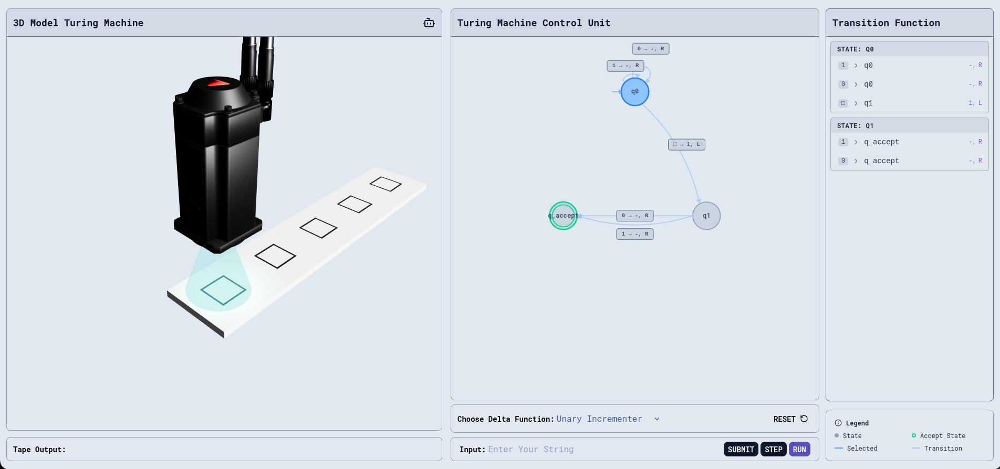

# A Three-Dimensional Visualisation of the Turing Machine

An interactive, browser-based simulator of a deterministic single-tape Turing machine, built to make the step-by-step behaviour of the model visible: the tape, the read/write head, and the state diagram of the control unit are drawn side by side and updated together on every transition.



**Live demo:** <https://erfannsb.github.io/3d_turing_machine>

> This project was written for educational purposes, as a teaching aid for the theory of computation. It is not intended as a general-purpose Turing machine runtime.

---

## Contents

1. [Motivation](#1-motivation)
2. [The model](#2-the-model)
3. [Machines included](#3-machines-included)
4. [How the simulator works](#4-how-the-simulator-works)
5. [Using the simulator](#5-using-the-simulator)
6. [Building from source](#6-building-from-source)
7. [Limitations](#7-limitations)
8. [References](#8-references)

---

## 1. Motivation

Textbook treatments of the Turing machine usually present it in two disconnected forms: a formal 7-tuple, and a state diagram printed on the page. Students are then asked to trace computations by hand, keeping the tape contents, the head position and the current state in their heads at once. Losing track of any one of them is where most mistakes happen.

This simulator puts all three on screen together. The tape is rendered as a row of cells in 3D with a physical head moving over it; next to it, the state diagram highlights the current state and the transition about to fire, and a table lists the transition function δ in full. Stepping through a computation one move at a time makes the correspondence between δ and the machine's behaviour easy to follow.

## 2. The model

The simulator implements the standard deterministic, single-tape Turing machine as defined in Sipser [2]:

$$
M = (Q,\ \Sigma,\ \Gamma,\ \delta,\ q_0,\ q_{\text{accept}},\ q_{\text{reject}})
$$

where

| Symbol | Meaning | In this project |
|---|---|---|
| $Q$ | finite set of states | depends on the chosen machine |
| $\Sigma$ | input alphabet | $\{0, 1\}$ |
| $\Gamma$ | tape alphabet, $\Sigma \cup \{\square\} \subseteq \Gamma$ | $\{0, 1, \square, X\}$ |
| $\delta$ | transition function $Q \times \Gamma \to Q \times \Gamma \times \{L, R\}$ | selected from the list below |
| $q_0$ | start state | `q0` |
| $q_{\text{accept}}$ | accepting state | `q_accept` |
| $q_{\text{reject}}$ | rejecting state | `q_reject` |

A transition is written in the interface as

```
a → b, D
```

meaning: *on reading `a`, write `b`, move the head in direction `D`*, and enter the target state indicated by the arrow in the diagram. As a notational convenience, writing `-` means "leave the cell unchanged".

The machine halts when it enters $q_{\text{accept}}$ or $q_{\text{reject}}$, or when δ is undefined for the current (state, symbol) pair.

## 3. Machines included

Three transition functions are provided. Each is small enough to trace by hand, and together they illustrate the three things a Turing machine typically does: **transform** the tape, **extend** it, and **decide** a language.

### 3.1 Unary Incrementer

Scans right to the first blank and writes a `1` there. On an input of the form $1^n$ this leaves $1^{n+1}$ on the tape, i.e. it computes $n \mapsto n + 1$ in unary.

| State | Read | Write | Move | Next |
|---|---|---|---|---|
| `q0` | `0` / `1` | – | R | `q0` |
| `q0` | `□` | `1` | L | `q1` |
| `q1` | `0` / `1` | – | R | `q_accept` |

### 3.2 Binary Complement

Inverts every bit of the input in a single left-to-right pass.

| State | Read | Write | Move | Next |
|---|---|---|---|---|
| `q0` | `0` | `1` | R | `q0` |
| `q0` | `1` | `0` | R | `q0` |
| `q0` | `□` | – | L | `q_accept` |

### 3.3 Even Length Checker

Decides the language $L = \{\, w \in \{0,1\}^* : |w| \text{ is even} \,\}$. The two non-halting states record the parity of the number of symbols read so far; each symbol is crossed out with `X` as it is consumed.

| State | Read | Write | Move | Next |
|---|---|---|---|---|
| `q0` | `0` / `1` | `X` | R | `q1` |
| `q0` | `□` | `□` | L | `q_accept` |
| `q1` | `0` / `1` | `X` | R | `q0` |
| `q1` | `□` | `□` | L | `q_reject` |

This is effectively a finite automaton running on a Turing machine, which is a useful point for discussion: the language is regular, so the tape's ability to be written to is never really needed.

## 4. How the simulator works

The application is a single-page React program. Its parts map closely onto the components of the formal model.

```
src/
├── logic/tm.ts   The machine itself: holds δ and computes a single step
├── storage.tsx   Global state (tape, head position, current state) via Zustand
├── CU.tsx        The control unit: state diagram, transition table, controls
└── App.tsx       The 3D scene: tape, head, lighting and camera
```

**Machine logic.** `TuringMachine.step(tape, head, state)` looks up $\delta(q, a)$ and returns the new tape, head position and state. It is a pure function of its inputs and knows nothing about rendering, which keeps the formal behaviour easy to audit independently of the interface.

**The tape.** Each cell is a thin box whose top face carries a texture drawn at runtime on an HTML canvas with the cell's current symbol. The head is a glTF model. A translucent cone beneath it turns **cyan** while the head is reading and briefly **red** when a symbol is written. The head and camera are moved by linear interpolation each frame, so the head glides between cells instead of jumping.

**The control unit.** States are laid out evenly on a circle, with `q0` at the top. Transitions between distinct states are drawn as quadratic Bézier curves, offset perpendicular to the line between the two states so that opposing edges do not overlap. Self-loops are drawn as cubic Bézier curves leaving and re-entering the same node. The active state and the transition about to be taken are highlighted in both the diagram and the table.

**Technologies.** React 19, TypeScript, Three.js through React Three Fiber and Drei, Zustand for state, Tailwind CSS for styling, and Vite as the build tool.

## 5. Using the simulator

1. Choose a machine from **Choose Delta Function**.
2. Type an input string over $\{0, 1\}$ and press **Submit**. The input is written to the tape, followed by blank cells, and the head is placed on the leftmost symbol in state `q0`.
3. Press **Step** to perform one transition, or **Run** to execute until the machine halts (about three steps per second).
4. Press **Reset** to clear the tape and return to `q0`.

The camera can be orbited and zoomed with the mouse.

**Manual mode.** The robot icon in the top-right corner of the 3D panel toggles a manual mode. In this mode you act as the control unit: the arrow keys move the head left and right, and the `0` and `1` keys write to the current cell. It is a good way to convince yourself that a machine works before watching it run.

## 6. Building from source

Requires Node.js 20.19 or later (needed by Vite 7).

```bash
git clone https://github.com/erfannsb/3d_turing_machine.git
cd 3d_turing_machine
npm install
npm run dev
```

The development server serves the app under `/3d_turing_machine/`, matching the GitHub Pages path.

| Command | Purpose |
|---|---|
| `npm run dev` | Start the Vite development server |
| `npm run build` | Type-check and produce a production build in `dist/` |
| `npm run preview` | Serve the production build locally |
| `npm run deploy` | Build and publish `dist/` to GitHub Pages |

## 7. Limitations

The simulator was built to illustrate the model, not to run arbitrary programs, and several simplifications follow from that.

- **Fixed machines.** δ is chosen from the three built-in machines; there is no editor for user-defined transition functions.
- **Finite tape.** The tape is the input followed by ten blank cells, rather than unbounded. This is sufficient for the included machines but does not model the infinite tape of the formal definition.
- **Input alphabet.** Inputs are restricted to $\{0, 1\}$, and the empty string cannot be submitted.
- **Deterministic, single-tape only.** Multi-tape and non-deterministic variants are not supported.

Natural extensions would be a transition-function editor, a dynamically growing tape, and a recorded trace of configurations $u\,q\,v$ for each step.

## 8. References

1. A. M. Turing, "On Computable Numbers, with an Application to the Entscheidungsproblem," *Proceedings of the London Mathematical Society*, s2-42(1), pp. 230–265, 1936.
2. M. Sipser, *Introduction to the Theory of Computation*, 3rd ed. Boston, MA: Cengage Learning, 2012, ch. 3.
3. J. E. Hopcroft, R. Motwani, and J. D. Ullman, *Introduction to Automata Theory, Languages, and Computation*, 3rd ed. Boston, MA: Addison-Wesley, 2006, ch. 8.
